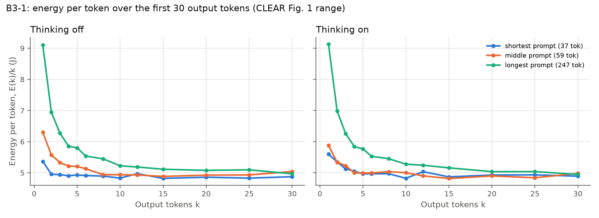
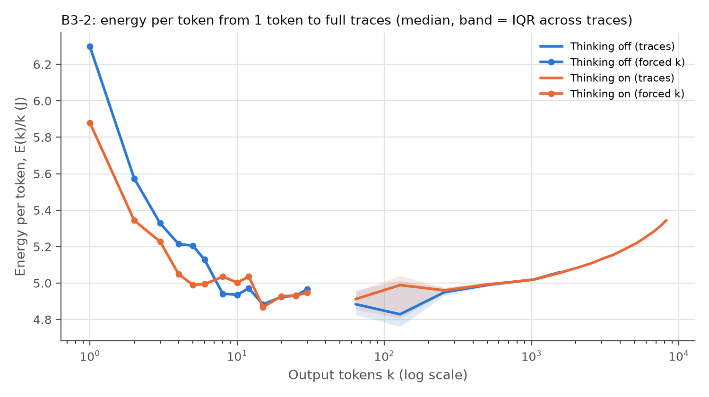

# Baselines — Results

**Spec:** `baselines.md`. **Runs:** 2026-10-17 to 2026-10-18, three slots on an NVIDIA RTX PRO 5000 Blackwell
(48 GB, driver 595.84, 300 W limit), plus B1 and B2a on an RTX 6000 Ada (medserver, driver 560).
All numbers come from `results/runs/`; the tables in `results/tables/` are produced by the analysis scripts named
in each section. Energy is GPU-only, from the NVML energy counter; idle power is **not** subtracted unless stated.

## Summary

| Baseline | Result | Status |
|---|---|---|
| **B1** CLEAR on BERT-base | CLEAR's method (one layer replayed × 12) captures only **74–83%** of whole-model energy (CLEAR reports 94–99%). Replaying the 12 layers **in sequence** raises it to **88–93%**. The single-layer replay undercounts because the layer stays in the GPU's L2 cache. | Done; ≥ 90% from 64 tokens up |
| **B2a** BERT-base on MRPC | Accuracy **87.75%**, F1 91.35%. **196 mJ/example** (RTX PRO 5000) and **316 mJ/example** (RTX 6000 Ada). | Done, both GPUs |
| **B2b** Qwen3-8B on MATH500 | Same accuracy in both modes (**90%**), but thinking-on uses **6.5×** more energy per query (19.8 vs 3.0 kJ; median 7.1× per problem). | Done, RTX PRO 5000 |
| **B3** Energy per token vs output tokens | Reproduces CLEAR Fig. 1: the first token costs 5.4–9.1 J (prefill), falling to a **5.0 J/token** plateau within 3–4 tokens. Per-token decode energy then rises slowly with context (+13% by 8k tokens). | Done, RTX PRO 5000 |
| Measurement checks | Zeus = NVML (+0.02%); checkpoint reads add no overhead; within-session trial spread ≤ 3%; **between-session drift 1–9%**. | Done |

Open: B2b and B3 on the RTX 6000 Ada (cross-GPU comparison).

---

## B1 — CLEAR on BERT-base

`b1/run_b1.py`, `b1/analyze_b1.py`, `b1/debug_capture.py`. FP16, SDPA attention, batch 1, layer 5, T = 20 trials;
components N = 10,000 repetitions per trial, full model and layers in sequence N = 1,000.

### %Capture(Model)

| Tokens | 8 | 32 | 64 | 96 | 128 |
|---|---|---|---|---|---|
| CLEAR paper (RTX 6000 Ada) | 96.7 | 93.8 | 98.6 | 97.2 | 97.8 |
| CLEAR's method, RTX 6000 Ada (ours) | 74.8 | 76.5 | 62.6 | 63.9 | 66.8 |
| CLEAR's method, RTX PRO 5000 | 74.0 | 79.0 | 81.8 | 83.3 | 81.7 |
| **Layers in sequence, RTX PRO 5000** | **88.4** | **88.7** | **91.8** | **91.6** | **92.8** |

CLEAR's method: Captured(Model) = 12 × one layer + embedding + MLM head. Ours: Captured(Model) = all 12 layers
replayed in sequence (each with its own captured input) + embedding + head.
Runs: `B1/20261018-160054_B1_gpu0_8f44f5d3` (8–96 tokens), `B1_L128/20261018-170312_...` (128 tokens),
`B1/20261018-121417_B1_gpu0_a489156e` (RTX 6000 Ada).

The first 128-token value was measured across two sessions after an SSH drop, which made it invalid because of
between-session drift (see the measurement checks). It was rerun in one session.

### Why CLEAR's method falls short

From `b1/debug_capture.py` (runs `B1debug*`):

1. **Cache residency (the main cause).** At 64 tokens, each of the 12 layers replayed alone costs the same
   (13.4–13.8 mJ, so layer 5 is representative). Run in sequence, they cost 10–15% more than 12 × one layer
   (`layers_cycled / (12 × block)` = 1.05–1.22 across lengths and sessions). A layer replayed 10,000 times keeps its
   ~7 MB of weights in L2; the real forward pass streams all 12 layers. A flushed-L2 replay was inconclusive,
   because the flush (≈ 70 mJ) dwarfs one layer's energy.
2. **No cost between modules.** encoder ÷ layers in sequence = 1.00–1.04, and (backbone + head) ÷ full model =
   0.96–0.98.
3. **Power state explains the rest.** At batch 1 the GPU is busy only 19–31% of a forward pass (profiler); the
   full model averages slightly more power than the layer replays (e.g. 166 W vs 155 W at 128 tokens).

**This finding applies to CLEAR itself:** its released code replays a single layer. All later component
measurements (Experiments A and C) should replay modules **in the order and with the variety they run in the
model**, not one module in isolation.

### Component energies, 64 tokens (RTX PRO 5000 vs CLEAR's paper)

| mJ per call | Embedding | Attention | FFN int. | FFN out | Norms | Block | 12 layers in seq. | Head | Full model |
|---|---|---|---|---|---|---|---|---|---|
| CLEAR (RTX 6000 Ada) | 8.00 | 17.99 | 3.70 | 5.95 | – | 34.98 | – | 31.17 | 465.4 |
| Ours (RTX PRO 5000) | 2.66 | 7.17 | 2.99 | 3.88 | 0.83 | 13.87 | 188.8 | 13.88 | 223.7 |

Absolute values are about half of CLEAR's on this newer GPU. %Capture(Block) (components ÷ block) is 87–107%
across lengths, passing CLEAR's check. Components under 5 mJ (norms, FFN-intermediate) have 10–35% trial spread,
as CLEAR's Appendix D predicts for small energies.

---

## B2a — BERT-base on MRPC (no thinking)

`b2/run_b2a.py`, `analysis/analyze_b2a.py`. `textattack/bert-base-uncased-MRPC`, FP16, GLUE MRPC validation
(408 pairs), batch 1, T = 10. Each dataset-pass window covers 5 passes (one pass is 0.65 s, too short for the counter).

| | RTX PRO 5000 | RTX 6000 Ada |
|---|---|---|
| Accuracy / F1 | 87.75% / 91.35% | 87.75% / 91.35% |
| Energy per example, dataset pass (NVML) | **196.3 mJ** (1.7%) | **315.6 mJ** (3.1%) |
| Idle-subtracted | 106.2 mJ | 150.2 mJ |
| Zeus vs NVML | +0.29% | 0.00% |
| Time per example | 1.59 ms | 3.94 ms |
| Per example, CLEAR method (26 → 86 tokens) | 185 → 237 mJ (1–4%) | — |

The two methods agree in scale: dataset-averaged 196 mJ vs 185–237 mJ for single examples across the length range.
Runs: `B2a/20261018-152007_B2a_gpu0_2f62426a`, `B2a/20261018-121427_B2a_gpu1_2f62426a`.

---

## B2b — Qwen3-8B on MATH500, thinking on vs off

`b2/run_b2b.py`, `analysis/analyze_b2b.py`. `Qwen/Qwen3-8B`, BF16, SDPA, batch 1; 30 MATH500 problems (6 per
level, `configs/math500_subset.json`); 3 trials per problem and mode; caps 2,048 (off) / 8,192 (on) tokens;
Qwen's recommended sampling; graded with `math-verify` 0.9.0.
Runs: `B2b/20261017-193728_B2b_gpu0_ba965317` (all off, on trials 0–1) + `B2b_extra/20261018-163010_...` (on trial 2).
Table: `results/tables/B2b_final.md`.

| | Thinking off | Thinking on |
|---|---|---|
| Accuracy | **90.0%** | **90.0%** |
| Output tokens per query | 606 | 3,794 (3,321 thinking + 473 answer) |
| **Energy per query** | **3.02 kJ** | **19.77 kJ** |
| Idle-subtracted | 2.39 kJ | 15.49 kJ |
| Energy per token | 4.96 J | 5.16 J |
| Energy per correct answer | 3.36 kJ | 21.97 kJ |
| Token cap hit | 2.2% | 11.1% |
| Trial spread, mJ/token (J/query) | 1.0% (10.2%) | 0.4% (11.3%) |
| Zeus vs NVML | +0.02% | +0.00% |

**On/off energy ratio:** 6.5× (ratio of means); per problem median 7.1×, range 3.5–11.7×. This is inside the
published ranges: Jin et al. 3.7–113×, Oviedo et al. ~13× (at ~5,000 vs ~300 output tokens, a longer ratio than ours).

By difficulty level:

| Level | 1 | 2 | 3 | 4 | 5 |
|---|---|---|---|---|---|
| Accuracy off / on | 100 / 100% | 83 / 94% | 100 / 100% | 94 / 83% | 72 / 72% |
| Energy per query off / on (kJ) | 1.3 / 11.0 | 2.8 / 23.6 | 2.3 / 12.8 | 3.3 / 22.3 | 5.4 / 29.2 |

Observations:
- **At this scale, thinking buys no accuracy on average for 6.5× the energy.** It helps at level 2 and hurts at
  level 4. With 30 problems the per-level differences (6 problems × 3 trials) are not significant.
- **Energy per query is almost entirely set by output length.** Energy per token is near-constant (4.96 vs 5.16 J),
  so the cost of thinking is its token count. This matches Jin et al.'s conclusion.
- **The token cap matters.** 11% of thinking-on runs hit 8,192 tokens, and almost all of those are wrong answers.
  Their energy understates the uncapped cost; they are excluded from Experiment C's budget curves.
- **The trial-spread check passes on energy per token (≤ 1%).** Energy per query varies ~10% between trials only
  because sampled answers differ in length.

Every trace (token IDs, `</think>` position, natural length) is saved in `traces.jsonl` for Experiment C.

---

## B3 — Energy per token vs output tokens

`b3/run_b3_short.py` (forced k = 1–30 tokens, CLEAR method, T = 5) and energy checkpoints inside the B2b runs;
`analysis/analyze_b3.py`. Figures: `results/figures/B3_final-{1_short,2_long,3_marginal}.png`;
table: `results/tables/B3_final.md`.



| Mode | First-token energy E(1): 37 / 59 / 247-token prompt | Plateau | k within 5% of plateau |
|---|---|---|---|
| Thinking off | 5.37 / 6.30 / 9.10 J | 5.03 J/token | 4 |
| Thinking on | 5.60 / 5.88 / 9.13 J | 5.03 J/token | 3 |

- **CLEAR Fig. 1 reproduces:** the prefill cost makes early tokens expensive, more so for longer prompts. It is
  spread over output tokens until energy per token settles at the decode cost. On this GPU the plateau arrives
  within 3–4 tokens; CLEAR's curves take 10–30. Thinking mode only changes the prompt template, so on and off
  behave the same at k ≤ 30.
- **Beyond CLEAR's range (B3-3):** in thinking-on traces, the energy per token between checkpoints grows with
  context, from **5.03 J at 512 tokens to 5.33 J at 4k and 5.68 J at 8k** (+13%). Caveat: only longer traces
  reach large k (n = 90 at 512 tokens, 10 at 8k), so the late points come from fewer, harder problems. This is the
  whole-model precursor to Experiment A: attention's KV-cache reads grow with context.



---

## Measurement checks

| Check | Result |
|---|---|
| Zeus vs raw NVML, same window | +0.02% mean in B2b; occasional single windows off by 1.5–3% (counter update timing); identical on long runs |
| Energy checkpoints during `generate()` | No overhead: same trace with/without, 8,169 vs 8,251 J (−1.0%, within noise) |
| Within-session trial spread | ≤ 3% for anything above 5 mJ (B1 blocks/model, B2a, B3-short); ≤ 1% J/token in B2b |
| B3-short rerun next day | Within ~1% (E(1) 5.40 / 6.36 / 9.11 J vs 5.37 / 6.30 / 9.10 J) |
| **Between-session drift** | Identical traces regenerated across sessions cost **1–9% different energy** (B2b repro −1.4 to −6%; speed check vs main run +5–9%); B1 at 64 tokens −4 to −7% next day |

**Implication:** compare configurations **within a session** wherever possible, and treat cross-session or
cross-day differences below ~10% as not significant. The cause is not identified yet. GPU temperature and clocks are
logged with every row for that analysis.

## Deviations from the spec (`baselines.md`)

- **GPUs:** RTX PRO 5000 Blackwell (slot server) and RTX 6000 Ada (medserver). B2b and B3 ran on the RTX PRO 5000
  only so far.
- **B1:** T = 20 at 5 lengths (spec: T = 10 at 4 lengths). The layers-in-sequence measurement was added.
- **B2b:** T-on raised from 2 to 3 (thinking-on ran faster than budgeted: ~60 tokens/s, ~65 s per problem).
- **B2a:** 5 dataset passes per energy window (a single pass is too short for the counter).
- **Precision:** BF16 for Qwen3 (CLEAR used FP16), as planned.

## Reproduce

```bash
python b1/run_b1.py                         && python b1/analyze_b1.py results/runs/B1/<run>
python b1/debug_capture.py --seq-lens 32 128
python b2/run_b2a.py                        && python analysis/analyze_b2a.py results/runs/B2a/<run>
python b2/run_b2b.py --T-on 3               && python analysis/analyze_b2b.py results/runs/B2b/<run>
python b3/run_b3_short.py                   && python analysis/analyze_b3.py --short results/runs/B3short/<run> --long results/runs/B2b/<run>
```

Environment and server setup: `scripts/slot_setup.sh`, `requirements-cu128.txt` (Blackwell) or `requirements.txt`
(RTX 6000 Ada). Every run directory has the exact command, git commit, config and per-trial raw counter values.
