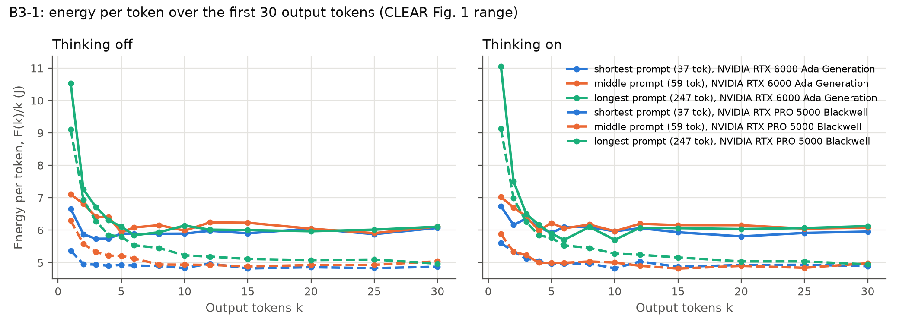
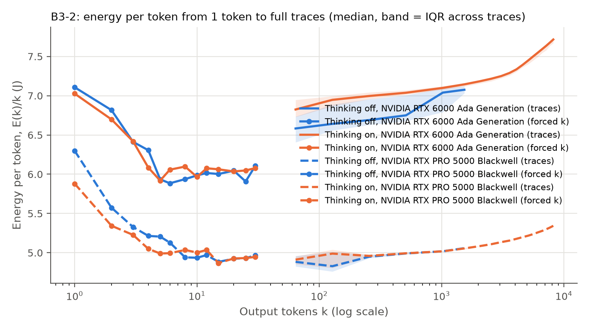
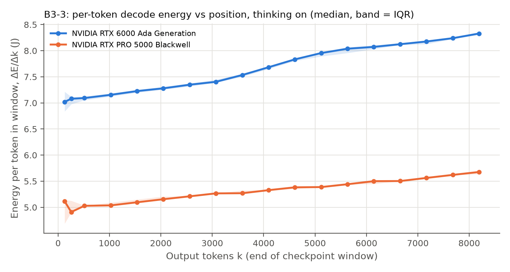

# B3: energy per token vs output tokens

Short runs: 20261017-192548_B3short_gpu0_4546c8ed, 20261019-122925_B3short_gpu1_4546c8ed
Long runs (B2b checkpoints): 20261017-193728_B2b_gpu0_ba965317, 20261019-122926_B2b_gpu0_feea8f05

| GPU | Mode | Prompt | k | E(k) mJ | std | E(k)/k mJ |
|---|---|---|---|---|---|---|
| NVIDIA RTX 6000 Ada Generation | off | longest | 1 | 10527.4 | 631.5 | 10527.4 |
| NVIDIA RTX 6000 Ada Generation | off | longest | 2 | 14514.6 | 1068.1 | 7257.3 |
| NVIDIA RTX 6000 Ada Generation | off | longest | 3 | 20139.7 | 917.9 | 6713.2 |
| NVIDIA RTX 6000 Ada Generation | off | longest | 4 | 25222.1 | 1959.2 | 6305.5 |
| NVIDIA RTX 6000 Ada Generation | off | longest | 5 | 30553.5 | 1373.3 | 6110.7 |
| NVIDIA RTX 6000 Ada Generation | off | longest | 6 | 35055.2 | 2204.8 | 5842.5 |
| NVIDIA RTX 6000 Ada Generation | off | longest | 8 | 47500.3 | 2822.2 | 5937.5 |
| NVIDIA RTX 6000 Ada Generation | off | longest | 10 | 61418.1 | 4016.6 | 6141.8 |
| NVIDIA RTX 6000 Ada Generation | off | longest | 12 | 72185.8 | 3473.1 | 6015.5 |
| NVIDIA RTX 6000 Ada Generation | off | longest | 15 | 90041.7 | 1731.5 | 6002.8 |
| NVIDIA RTX 6000 Ada Generation | off | longest | 20 | 119326.1 | 5607.8 | 5966.3 |
| NVIDIA RTX 6000 Ada Generation | off | longest | 25 | 150395.2 | 9429.4 | 6015.8 |
| NVIDIA RTX 6000 Ada Generation | off | longest | 30 | 183218.7 | 7925.5 | 6107.3 |
| NVIDIA RTX 6000 Ada Generation | off | middle | 1 | 7107.1 | 139.3 | 7107.1 |
| NVIDIA RTX 6000 Ada Generation | off | middle | 2 | 13632.4 | 272.9 | 6816.2 |
| NVIDIA RTX 6000 Ada Generation | off | middle | 3 | 19236.8 | 697.8 | 6412.3 |
| NVIDIA RTX 6000 Ada Generation | off | middle | 4 | 25594.3 | 1390.8 | 6398.6 |
| NVIDIA RTX 6000 Ada Generation | off | middle | 5 | 29674.0 | 1823.2 | 5934.8 |
| NVIDIA RTX 6000 Ada Generation | off | middle | 6 | 36491.5 | 1548.6 | 6081.9 |
| NVIDIA RTX 6000 Ada Generation | off | middle | 8 | 49245.2 | 3592.1 | 6155.7 |
| NVIDIA RTX 6000 Ada Generation | off | middle | 10 | 59849.7 | 2754.3 | 5985.0 |
| NVIDIA RTX 6000 Ada Generation | off | middle | 12 | 74888.2 | 2683.6 | 6240.7 |
| NVIDIA RTX 6000 Ada Generation | off | middle | 15 | 93440.7 | 3111.5 | 6229.4 |
| NVIDIA RTX 6000 Ada Generation | off | middle | 20 | 120906.7 | 1661.2 | 6045.3 |
| NVIDIA RTX 6000 Ada Generation | off | middle | 25 | 147692.8 | 6859.0 | 5907.7 |
| NVIDIA RTX 6000 Ada Generation | off | middle | 30 | 183385.3 | 9240.3 | 6112.8 |
| NVIDIA RTX 6000 Ada Generation | off | shortest | 1 | 6658.0 | 643.6 | 6658.0 |
| NVIDIA RTX 6000 Ada Generation | off | shortest | 2 | 11753.4 | 926.0 | 5876.7 |
| NVIDIA RTX 6000 Ada Generation | off | shortest | 3 | 17206.8 | 1272.1 | 5735.6 |
| NVIDIA RTX 6000 Ada Generation | off | shortest | 4 | 22956.8 | 1096.7 | 5739.2 |
| NVIDIA RTX 6000 Ada Generation | off | shortest | 5 | 29493.0 | 1517.2 | 5898.6 |
| NVIDIA RTX 6000 Ada Generation | off | shortest | 6 | 35307.5 | 2756.7 | 5884.6 |
| NVIDIA RTX 6000 Ada Generation | off | shortest | 8 | 47120.3 | 2411.0 | 5890.0 |
| NVIDIA RTX 6000 Ada Generation | off | shortest | 10 | 58931.2 | 2455.7 | 5893.1 |
| NVIDIA RTX 6000 Ada Generation | off | shortest | 12 | 71767.0 | 2999.4 | 5980.6 |
| NVIDIA RTX 6000 Ada Generation | off | shortest | 15 | 88541.3 | 4122.3 | 5902.8 |
| NVIDIA RTX 6000 Ada Generation | off | shortest | 20 | 120923.9 | 8075.1 | 6046.2 |
| NVIDIA RTX 6000 Ada Generation | off | shortest | 25 | 146929.6 | 5580.5 | 5877.2 |
| NVIDIA RTX 6000 Ada Generation | off | shortest | 30 | 182090.9 | 9519.9 | 6069.7 |
| NVIDIA RTX 6000 Ada Generation | on | longest | 1 | 11051.1 | 598.0 | 11051.1 |
| NVIDIA RTX 6000 Ada Generation | on | longest | 2 | 15006.0 | 1307.9 | 7503.0 |
| NVIDIA RTX 6000 Ada Generation | on | longest | 3 | 19510.1 | 858.4 | 6503.4 |
| NVIDIA RTX 6000 Ada Generation | on | longest | 4 | 24653.9 | 1482.1 | 6163.5 |
| NVIDIA RTX 6000 Ada Generation | on | longest | 5 | 29461.9 | 1385.7 | 5892.4 |
| NVIDIA RTX 6000 Ada Generation | on | longest | 6 | 34231.0 | 670.6 | 5705.2 |
| NVIDIA RTX 6000 Ada Generation | on | longest | 8 | 48778.6 | 2765.6 | 6097.3 |
| NVIDIA RTX 6000 Ada Generation | on | longest | 10 | 57043.5 | 2682.7 | 5704.4 |
| NVIDIA RTX 6000 Ada Generation | on | longest | 12 | 72910.6 | 3450.9 | 6075.9 |
| NVIDIA RTX 6000 Ada Generation | on | longest | 15 | 90938.9 | 6140.6 | 6062.6 |
| NVIDIA RTX 6000 Ada Generation | on | longest | 20 | 120707.8 | 3673.5 | 6035.4 |
| NVIDIA RTX 6000 Ada Generation | on | longest | 25 | 151634.2 | 968.7 | 6065.4 |
| NVIDIA RTX 6000 Ada Generation | on | longest | 30 | 183791.9 | 8582.4 | 6126.4 |
| NVIDIA RTX 6000 Ada Generation | on | middle | 1 | 7026.3 | 281.7 | 7026.3 |
| NVIDIA RTX 6000 Ada Generation | on | middle | 2 | 13395.9 | 1149.0 | 6698.0 |
| NVIDIA RTX 6000 Ada Generation | on | middle | 3 | 19258.4 | 220.5 | 6419.5 |
| NVIDIA RTX 6000 Ada Generation | on | middle | 4 | 23965.0 | 1318.2 | 5991.3 |
| NVIDIA RTX 6000 Ada Generation | on | middle | 5 | 31102.7 | 1476.8 | 6220.5 |
| NVIDIA RTX 6000 Ada Generation | on | middle | 6 | 36347.6 | 2226.5 | 6057.9 |
| NVIDIA RTX 6000 Ada Generation | on | middle | 8 | 49377.3 | 3337.5 | 6172.2 |
| NVIDIA RTX 6000 Ada Generation | on | middle | 10 | 59698.6 | 3392.7 | 5969.9 |
| NVIDIA RTX 6000 Ada Generation | on | middle | 12 | 74377.2 | 3490.6 | 6198.1 |
| NVIDIA RTX 6000 Ada Generation | on | middle | 15 | 92342.9 | 4225.8 | 6156.2 |
| NVIDIA RTX 6000 Ada Generation | on | middle | 20 | 123066.0 | 1958.5 | 6153.3 |
| NVIDIA RTX 6000 Ada Generation | on | middle | 25 | 151199.7 | 3694.2 | 6048.0 |
| NVIDIA RTX 6000 Ada Generation | on | middle | 30 | 182348.5 | 6873.3 | 6078.3 |
| NVIDIA RTX 6000 Ada Generation | on | shortest | 1 | 6739.3 | 433.3 | 6739.3 |
| NVIDIA RTX 6000 Ada Generation | on | shortest | 2 | 12317.5 | 767.9 | 6158.8 |
| NVIDIA RTX 6000 Ada Generation | on | shortest | 3 | 19095.2 | 817.2 | 6365.1 |
| NVIDIA RTX 6000 Ada Generation | on | shortest | 4 | 24338.7 | 1349.7 | 6084.7 |
| NVIDIA RTX 6000 Ada Generation | on | shortest | 5 | 29595.4 | 1386.4 | 5919.1 |
| NVIDIA RTX 6000 Ada Generation | on | shortest | 6 | 36596.5 | 1113.6 | 6099.4 |
| NVIDIA RTX 6000 Ada Generation | on | shortest | 8 | 48738.6 | 2395.4 | 6092.3 |
| NVIDIA RTX 6000 Ada Generation | on | shortest | 10 | 59652.7 | 4570.7 | 5965.3 |
| NVIDIA RTX 6000 Ada Generation | on | shortest | 12 | 72737.4 | 3310.6 | 6061.4 |
| NVIDIA RTX 6000 Ada Generation | on | shortest | 15 | 89035.5 | 4354.9 | 5935.7 |
| NVIDIA RTX 6000 Ada Generation | on | shortest | 20 | 116176.3 | 6967.7 | 5808.8 |
| NVIDIA RTX 6000 Ada Generation | on | shortest | 25 | 147877.6 | 6957.4 | 5915.1 |
| NVIDIA RTX 6000 Ada Generation | on | shortest | 30 | 178698.9 | 6623.8 | 5956.6 |
| NVIDIA RTX PRO 5000 Blackwell | off | longest | 1 | 9102.3 | 273.5 | 9102.3 |
| NVIDIA RTX PRO 5000 Blackwell | off | longest | 2 | 13885.5 | 394.0 | 6942.8 |
| NVIDIA RTX PRO 5000 Blackwell | off | longest | 3 | 18818.4 | 571.0 | 6272.8 |
| NVIDIA RTX PRO 5000 Blackwell | off | longest | 4 | 23404.6 | 714.4 | 5851.1 |
| NVIDIA RTX PRO 5000 Blackwell | off | longest | 5 | 28996.8 | 730.7 | 5799.4 |
| NVIDIA RTX PRO 5000 Blackwell | off | longest | 6 | 33217.9 | 974.8 | 5536.3 |
| NVIDIA RTX PRO 5000 Blackwell | off | longest | 8 | 43595.9 | 1428.6 | 5449.5 |
| NVIDIA RTX PRO 5000 Blackwell | off | longest | 10 | 52243.8 | 1587.0 | 5224.4 |
| NVIDIA RTX PRO 5000 Blackwell | off | longest | 12 | 62220.6 | 1732.4 | 5185.1 |
| NVIDIA RTX PRO 5000 Blackwell | off | longest | 15 | 76700.8 | 2326.4 | 5113.4 |
| NVIDIA RTX PRO 5000 Blackwell | off | longest | 20 | 101535.9 | 3253.5 | 5076.8 |
| NVIDIA RTX PRO 5000 Blackwell | off | longest | 25 | 127384.3 | 3370.0 | 5095.4 |
| NVIDIA RTX PRO 5000 Blackwell | off | longest | 30 | 149016.7 | 4332.0 | 4967.2 |
| NVIDIA RTX PRO 5000 Blackwell | off | middle | 1 | 6298.0 | 138.9 | 6298.0 |
| NVIDIA RTX PRO 5000 Blackwell | off | middle | 2 | 11147.9 | 308.7 | 5573.9 |
| NVIDIA RTX PRO 5000 Blackwell | off | middle | 3 | 15984.5 | 539.8 | 5328.2 |
| NVIDIA RTX PRO 5000 Blackwell | off | middle | 4 | 20859.0 | 566.2 | 5214.7 |
| NVIDIA RTX PRO 5000 Blackwell | off | middle | 5 | 26026.9 | 739.6 | 5205.4 |
| NVIDIA RTX PRO 5000 Blackwell | off | middle | 6 | 30775.1 | 911.0 | 5129.2 |
| NVIDIA RTX PRO 5000 Blackwell | off | middle | 8 | 39531.5 | 111.3 | 4941.4 |
| NVIDIA RTX PRO 5000 Blackwell | off | middle | 10 | 49362.6 | 1577.7 | 4936.3 |
| NVIDIA RTX PRO 5000 Blackwell | off | middle | 12 | 59146.5 | 1242.4 | 4928.9 |
| NVIDIA RTX PRO 5000 Blackwell | off | middle | 15 | 73253.8 | 1630.7 | 4883.6 |
| NVIDIA RTX PRO 5000 Blackwell | off | middle | 20 | 98492.3 | 3508.2 | 4924.6 |
| NVIDIA RTX PRO 5000 Blackwell | off | middle | 25 | 123271.1 | 3262.2 | 4930.8 |
| NVIDIA RTX PRO 5000 Blackwell | off | middle | 30 | 151205.7 | 2679.8 | 5040.2 |
| NVIDIA RTX PRO 5000 Blackwell | off | shortest | 1 | 5366.6 | 7.0 | 5366.6 |
| NVIDIA RTX PRO 5000 Blackwell | off | shortest | 2 | 9905.6 | 293.2 | 4952.8 |
| NVIDIA RTX PRO 5000 Blackwell | off | shortest | 3 | 14812.4 | 582.7 | 4937.5 |
| NVIDIA RTX PRO 5000 Blackwell | off | shortest | 4 | 19619.7 | 594.8 | 4904.9 |
| NVIDIA RTX PRO 5000 Blackwell | off | shortest | 5 | 24638.3 | 651.5 | 4927.7 |
| NVIDIA RTX PRO 5000 Blackwell | off | shortest | 6 | 29464.9 | 870.7 | 4910.8 |
| NVIDIA RTX PRO 5000 Blackwell | off | shortest | 8 | 39155.0 | 1093.3 | 4894.4 |
| NVIDIA RTX PRO 5000 Blackwell | off | shortest | 10 | 48297.7 | 1745.5 | 4829.8 |
| NVIDIA RTX PRO 5000 Blackwell | off | shortest | 12 | 59649.0 | 356.1 | 4970.7 |
| NVIDIA RTX PRO 5000 Blackwell | off | shortest | 15 | 72294.6 | 1818.6 | 4819.6 |
| NVIDIA RTX PRO 5000 Blackwell | off | shortest | 20 | 97155.9 | 2007.6 | 4857.8 |
| NVIDIA RTX PRO 5000 Blackwell | off | shortest | 25 | 120711.1 | 3070.0 | 4828.4 |
| NVIDIA RTX PRO 5000 Blackwell | off | shortest | 30 | 146213.7 | 467.7 | 4873.8 |
| NVIDIA RTX PRO 5000 Blackwell | on | longest | 1 | 9131.8 | 236.2 | 9131.8 |
| NVIDIA RTX PRO 5000 Blackwell | on | longest | 2 | 13967.4 | 470.8 | 6983.7 |
| NVIDIA RTX PRO 5000 Blackwell | on | longest | 3 | 18759.4 | 561.0 | 6253.1 |
| NVIDIA RTX PRO 5000 Blackwell | on | longest | 4 | 23363.1 | 778.4 | 5840.8 |
| NVIDIA RTX PRO 5000 Blackwell | on | longest | 5 | 28830.2 | 700.8 | 5766.0 |
| NVIDIA RTX PRO 5000 Blackwell | on | longest | 6 | 33188.3 | 983.5 | 5531.4 |
| NVIDIA RTX PRO 5000 Blackwell | on | longest | 8 | 43615.7 | 1410.3 | 5452.0 |
| NVIDIA RTX PRO 5000 Blackwell | on | longest | 10 | 52772.7 | 1434.2 | 5277.3 |
| NVIDIA RTX PRO 5000 Blackwell | on | longest | 12 | 62901.1 | 1675.6 | 5241.8 |
| NVIDIA RTX PRO 5000 Blackwell | on | longest | 15 | 77374.9 | 2338.7 | 5158.3 |
| NVIDIA RTX PRO 5000 Blackwell | on | longest | 20 | 100734.3 | 2940.0 | 5036.7 |
| NVIDIA RTX PRO 5000 Blackwell | on | longest | 25 | 125935.9 | 3380.3 | 5037.4 |
| NVIDIA RTX PRO 5000 Blackwell | on | longest | 30 | 148407.1 | 2875.2 | 4946.9 |
| NVIDIA RTX PRO 5000 Blackwell | on | middle | 1 | 5879.6 | 55.6 | 5879.6 |
| NVIDIA RTX PRO 5000 Blackwell | on | middle | 2 | 10666.6 | 293.5 | 5333.3 |
| NVIDIA RTX PRO 5000 Blackwell | on | middle | 3 | 15682.8 | 494.8 | 5227.6 |
| NVIDIA RTX PRO 5000 Blackwell | on | middle | 4 | 20001.2 | 513.6 | 5000.3 |
| NVIDIA RTX PRO 5000 Blackwell | on | middle | 5 | 24951.7 | 675.5 | 4990.3 |
| NVIDIA RTX PRO 5000 Blackwell | on | middle | 6 | 29966.8 | 948.9 | 4994.5 |
| NVIDIA RTX PRO 5000 Blackwell | on | middle | 8 | 40282.9 | 472.8 | 5035.4 |
| NVIDIA RTX PRO 5000 Blackwell | on | middle | 10 | 50028.5 | 1264.2 | 5002.9 |
| NVIDIA RTX PRO 5000 Blackwell | on | middle | 12 | 58818.6 | 1567.4 | 4901.6 |
| NVIDIA RTX PRO 5000 Blackwell | on | middle | 15 | 72235.2 | 831.0 | 4815.7 |
| NVIDIA RTX PRO 5000 Blackwell | on | middle | 20 | 97971.7 | 642.4 | 4898.6 |
| NVIDIA RTX PRO 5000 Blackwell | on | middle | 25 | 121000.1 | 3158.9 | 4840.0 |
| NVIDIA RTX PRO 5000 Blackwell | on | middle | 30 | 149410.8 | 2605.3 | 4980.4 |
| NVIDIA RTX PRO 5000 Blackwell | on | shortest | 1 | 5599.9 | 167.4 | 5599.9 |
| NVIDIA RTX PRO 5000 Blackwell | on | shortest | 2 | 10687.1 | 240.9 | 5343.6 |
| NVIDIA RTX PRO 5000 Blackwell | on | shortest | 3 | 15377.0 | 466.5 | 5125.7 |
| NVIDIA RTX PRO 5000 Blackwell | on | shortest | 4 | 20199.9 | 668.7 | 5050.0 |
| NVIDIA RTX PRO 5000 Blackwell | on | shortest | 5 | 24842.5 | 810.4 | 4968.5 |
| NVIDIA RTX PRO 5000 Blackwell | on | shortest | 6 | 29804.6 | 876.6 | 4967.4 |
| NVIDIA RTX PRO 5000 Blackwell | on | shortest | 8 | 39767.3 | 1179.7 | 4970.9 |
| NVIDIA RTX PRO 5000 Blackwell | on | shortest | 10 | 48227.3 | 606.4 | 4822.7 |
| NVIDIA RTX PRO 5000 Blackwell | on | shortest | 12 | 60426.4 | 1105.5 | 5035.5 |
| NVIDIA RTX PRO 5000 Blackwell | on | shortest | 15 | 73025.7 | 2135.4 | 4868.4 |
| NVIDIA RTX PRO 5000 Blackwell | on | shortest | 20 | 98547.0 | 2585.3 | 4927.4 |
| NVIDIA RTX PRO 5000 Blackwell | on | shortest | 25 | 123311.8 | 3054.9 | 4932.5 |
| NVIDIA RTX PRO 5000 Blackwell | on | shortest | 30 | 146724.9 | 4625.4 | 4890.8 |

## Table B3

| GPU | Mode | E(1) shortest / middle / longest (J) | Plateau (J/token) | k within 5% of plateau |
|---|---|---|---|---|
| NVIDIA RTX 6000 Ada Generation | off | 6.66 / 7.11 / 10.53 | 6.866 | 1 |
| NVIDIA RTX 6000 Ada Generation | on | 6.74 / 7.03 / 11.05 | 7.108 | 1 |
| NVIDIA RTX PRO 5000 Blackwell | off | 5.37 / 6.30 / 9.10 | 5.025 | 4 |
| NVIDIA RTX PRO 5000 Blackwell | on | 5.60 / 5.88 / 9.13 | 5.033 | 3 |
